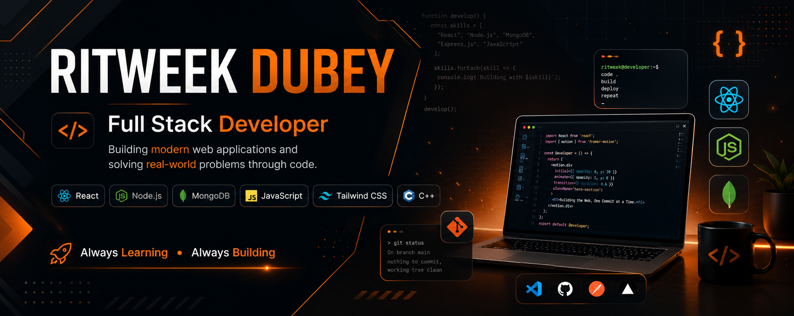

<div align="center">



# Hi 👋, I'm Ritweek Dubey

### 🚀 Full Stack Developer | 💻 Computer Science Engineering Student


<br/>

<a href="https://portfolio-site-jube.vercel.app/">

</a>

<a href="https://www.linkedin.com/in/ritweek17/">

</a>

<a href="mailto:ritweekdubey2006@gmail.com">

</a>

<a href="https://github.com/Ritweek17">

</a>

</div>

---

# 👨‍💻 About Me

```cpp
class RitweekDubey {

public:

    string role = "Full Stack Developer";

    string college = "ABES Engineering College";

    vector<string> interests = {

        "Full Stack Development",
        "Backend Development",
        "Data Structures & Algorithms",
        "Open Source"

    };

    vector<string> currentlyLearning = {

        "Node.js",
        "Express.js",
        "MongoDB",
        "System Design"

    };

};
```

## 🚀 Tech Stack

### 💻 Languages

<p>

</p>

### ⚛️ Frontend

<p>

</p>

### ⚙️ Backend

<p>

</p>

### 🛠 Tools

<p>

</p>

### 📚 Libraries

- GSAP
- Framer Motion
- Lenis
- React Icons

---

# 🚀 Featured Projects

## 🏢 ClearFiling

Business Compliance Platform built for a real client.

🌐 **Live:** https://www.clearfiling.co.in/

💻 **Repository:** https://github.com/Ritweek17/ClearFiling

---

## 🧩 MeowMaze

Logic puzzle game built with React.

🌐 **Live:** https://meowmaze-ruby.vercel.app/

💻 **Repository:** https://github.com/Ritweek17/Puzzle-game

---

## 💼 Developer Portfolio

Modern animated portfolio website.

🌐 **Live:** https://portfolio-site-jube.vercel.app/

💻 **Repository:** https://github.com/Ritweek17/Portfolio-Site

---

## 🛒 Amazon Clone

Responsive E-Commerce Frontend.

🌐 **Live:** https://amazon-clone-f20x.onrender.com/

💻 **Repository:** https://github.com/Ritweek17/AMAZON-CLONE

---

# 🏆 Certifications

- ✅ FreeCodeCamp – JavaScript Algorithms & Data Structures
- ✅ HackerRank – Problem Solving (Basic)
- ✅ HackerRank – CSS (Basic)
- ✅ CodeChef – 500 Difficulty Problems
- ✅ Simplilearn – HTML
- ✅ Simplilearn – CSS

---

# 💻 Coding Profiles

| Platform | Link |
|----------|------|
| LeetCode | https://leetcode.com/u/Ritweek_Dubey/ |
| CodeChef | https://www.codechef.com/users/ritweek_17 |
| HackerRank | https://www.hackerrank.com/profile/ritweekdubey2006 |
| Codeforces | https://codeforces.com/profile/ritweekdubey2006 |
| GeeksforGeeks | https://www.geeksforgeeks.org/user/ritweek17 |
| InterviewBit | https://www.interviewbit.com/profile/ritweek-dubey |
| AtCoder | https://atcoder.jp/users/ritweek_17 |

---

# 📈 GitHub Stats

> GitHub stat cards are provided by third-party services and may occasionally take a few moments to load.

<p align="center">


</p>

<p align="center">


</p>

---

# 🎯 2026 Goals

- ✅ Become a MERN Stack Developer
- ✅ Solve 1k+ DSA Problems
- ✅ Build Production-Level Projects
- ✅ Contribute to Open Source
- ✅ Secure a Software Development Internship

---

# 📬 Contact

📧 **Email:**  
**ritweekdubey2006@gmail.com**

🌐 **Portfolio:**  
https://portfolio-site-jube.vercel.app/

💼 **LinkedIn:**  
https://www.linkedin.com/in/ritweek17/

---

<div align="center">

## ⭐ Thanks for visiting my profile!

### 🚀 Building • Learning • Improving

</div>
