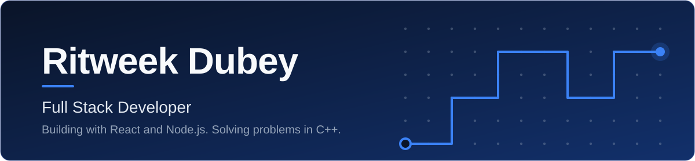

  
  
  

## About

I'm a B.Tech Computer Science student at ABES Engineering College who likes turning ideas into working products. I started with frontend development, moved into React, and I'm now building out the backend side of the MERN stack.

- 7+ projects built and deployed, from e-commerce and games to client work
- 900+ coding problems solved (700+ on CodeChef, 150+ on LeetCode, 50+ elsewhere)
- Web Development Intern at Clear Filing & Compliance LLP
- I learn by building and solve by doing

## Currently working on

- Backend development with Node.js, Express.js and MongoDB, to build full MERN projects
- System design fundamentals
- Contest practice to sharpen my DSA and competitive programming

## Tech stack

| | |
|---|---|
| **Languages** |  |
| **Frontend** |  |
| **Backend** |  |
| **Tools** |  |

**Libraries:** GSAP, Framer Motion, Lenis, React Icons

## Featured projects

**[ClearFiling](https://www.clearfiling.co.in/)** ([code](https://github.com/Ritweek17/ClearFiling))
A client-facing platform for a corporate compliance and business services firm, built with React, Vite and Tailwind CSS. It includes service pages, search and filtering, contact forms and a reusable component system.

**[MeowMaze](https://meowmaze-ruby.vercel.app/)** ([code](https://github.com/Ritweek17/Puzzle-game))
A logic puzzle game built with React.

**[Developer Portfolio](https://portfolio-site-jube.vercel.app/)** ([code](https://github.com/Ritweek17/Portfolio-Site))
My animated, responsive portfolio website.

More projects are on my [repositories page](https://github.com/Ritweek17?tab=repositories).

## Experience

**Web Development Intern, Clear Filing & Compliance LLP** (July 2026 to September 2026, New Delhi)

- Built and deployed responsive interfaces with React.js, Vite, JavaScript and Tailwind CSS
- Created reusable UI components and a consistent design system
- Connected frontend interfaces to backend services and APIs
- Added SEO basics, Open Graph metadata and accessibility improvements
- Turned business requirements into user-friendly pages, working in a Git-based workflow

## Leadership and community

- **Joint Secretary**, ACES
- **Marketing Team member**, ACES
- **Gender Champion**, Stambh – Pillar of Equality

## Problem solving

| Platform | Profile |
|---|---|
| CodeChef (700+ solved) | [ritweek_17](https://www.codechef.com/users/ritweek_17) |
| LeetCode (150+ solved) | [Ritweek_Dubey](https://leetcode.com/u/Ritweek_Dubey/) |
| Codeforces | [ritweekdubey2006](https://codeforces.com/profile/ritweekdubey2006) |
| AtCoder | [ritweek_17](https://atcoder.jp/users/ritweek_17) |
| HackerRank | [ritweekdubey2006](https://www.hackerrank.com/profile/ritweekdubey2006) |
| GeeksforGeeks | [ritweek17](https://www.geeksforgeeks.org/user/ritweek17) |
| InterviewBit | [ritweek-dubey](https://www.interviewbit.com/profile/ritweek-dubey) |

## Certifications

- freeCodeCamp: JavaScript Algorithms and Data Structures
- HackerRank: Problem Solving (Basic) and CSS (Basic)
- CodeChef: 500 Difficulty Rating Practice Completion
- Simplilearn: HTML and CSS

## GitHub activity

## Goals

- Solve 1,000+ DSA problems (900+ done)
- Contribute to open source
- Take part in hackathons
- Land my next software development internship

## Contact

- Email: [ritweekdubey2006@gmail.com](mailto:ritweekdubey2006@gmail.com)
- Portfolio: [portfolio-site-jube.vercel.app](https://portfolio-site-jube.vercel.app/)
- LinkedIn: [linkedin.com/in/ritweekdubey](https://www.linkedin.com/in/ritweekdubey)